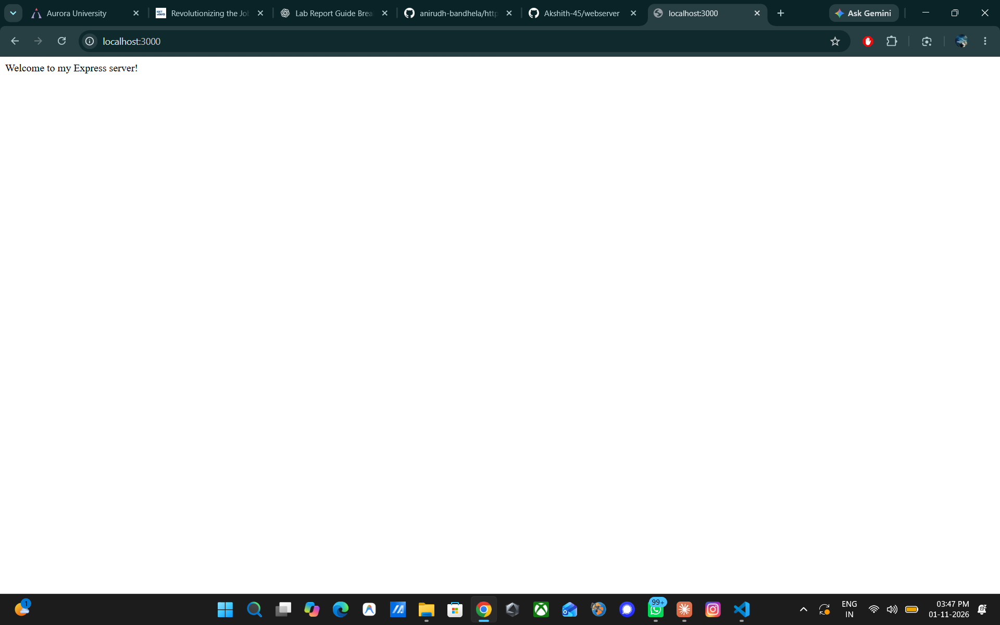
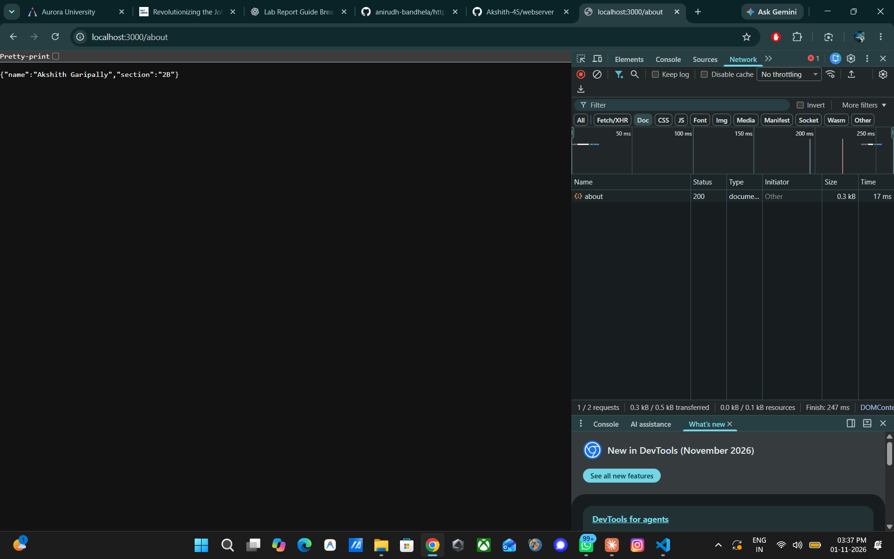
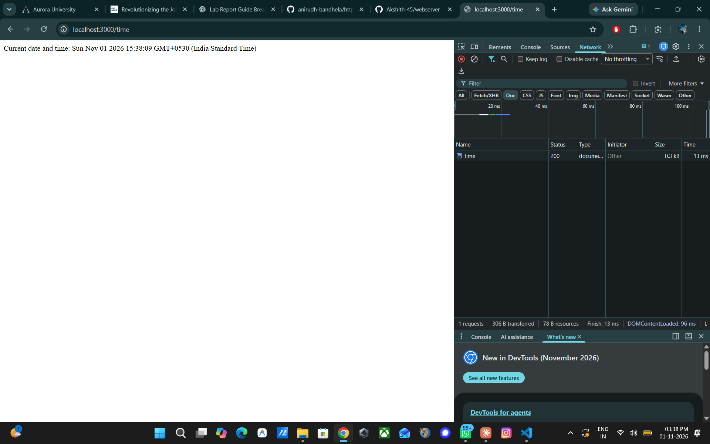
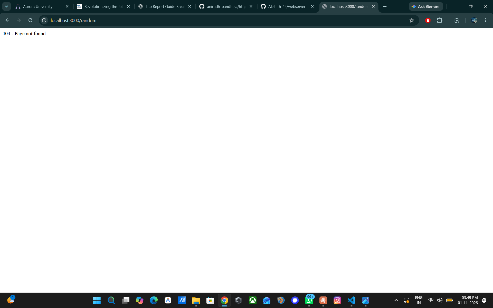
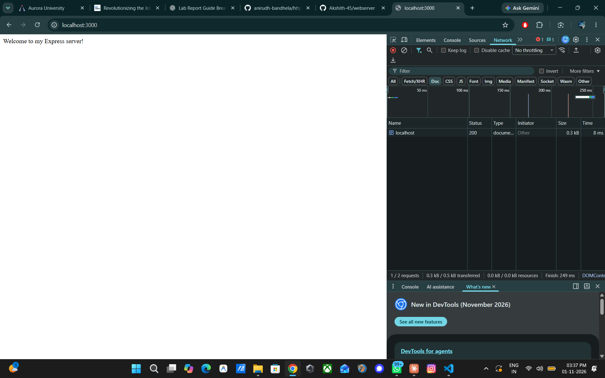
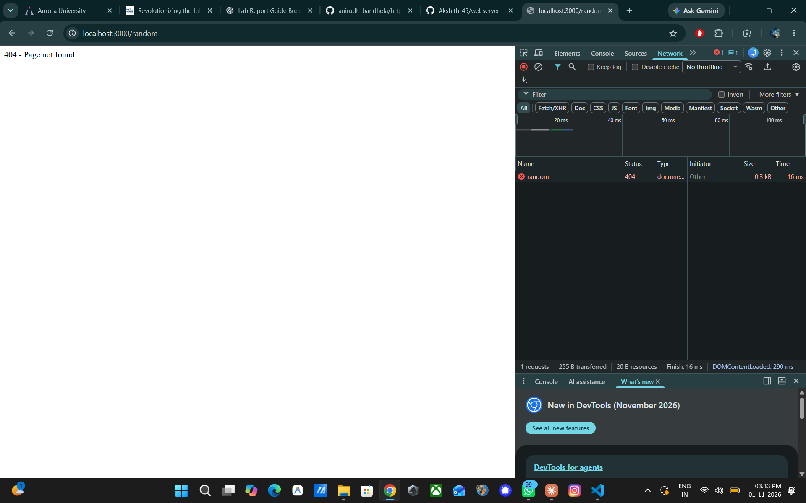

# Lab 1: Node.js and Express server

**Akshith Garipally** · Registration No: 252U1R6075 · Section 2B

**Live link:** https://bdf-labs-s5zk.onrender.com/

## About

A small web server built first with Node's built-in `http` module (`plain-server.js`) and then with Express (`server.js`). It serves three routes and returns a 404 message for any unknown path.

## How to run

1. Install dependencies: `npm install`
2. Start the Express server: `npm start`
3. Open http://localhost:3000
4. (Optional) Run the plain `http` version instead: `npm run plain`

Environment variables: none required. `PORT` is optional and defaults to 3000.

## Endpoints

| Method | Path | Description |
|---|---|---|
| GET | / | Welcome text |
| GET | /about | JSON with name and section |
| GET | /time | Current date and time (`new Date()`) |
| GET | any other path | 404 message ("404 - Page not found") |

## Status codes observed

| Route | Status |
|---|---|
| / | 200 |
| /about | 200 |
| /time | 200 |
| /random (unknown path) | 404 |

## Screenshots

### Routes in the browser

### Status codes in Chrome DevTools (Network tab)

## Project files

- `server.js`: Express server with the three routes and the 404 handler
- `plain-server.js`: plain server using the built-in `http` module
- `package.json`: project details, scripts and dependencies
- `.gitignore`: keeps `node_modules` and `.env` out of the repository

## Notes: problems faced and how I solved them

- PowerShell blocked `npm` with an execution policy error. I fixed it by running `Set-ExecutionPolicy -Scope CurrentUser -ExecutionPolicy RemoteSigned`.
- `npm start` printed nothing the first time because `server.js` was not saved. I saved the file and ran it again.
- The browser showed 304 on refresh because of caching. I ticked "Disable cache" in DevTools to see the real 200 status.
- `favicon.ico` shows 404 in DevTools because Chrome requests it automatically and the server has no route for it. This is expected.
- The 404 handler must be placed after all routes, otherwise it would catch valid requests.