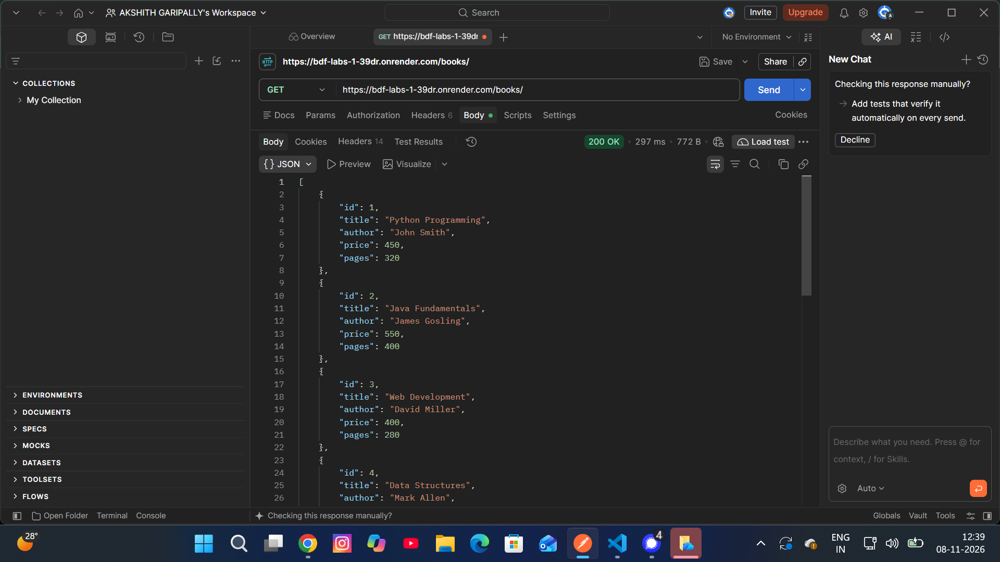
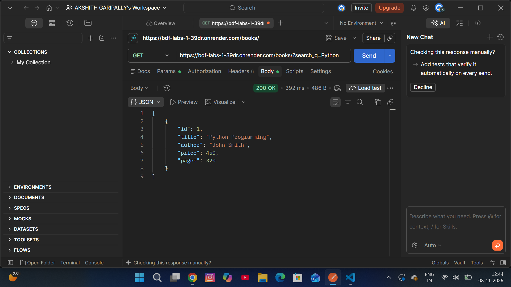
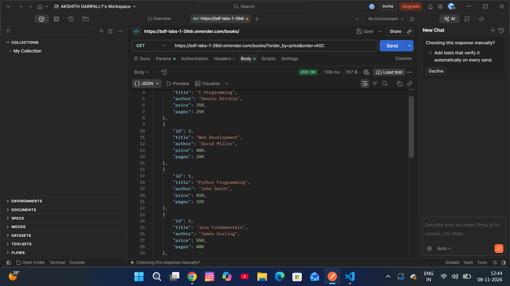
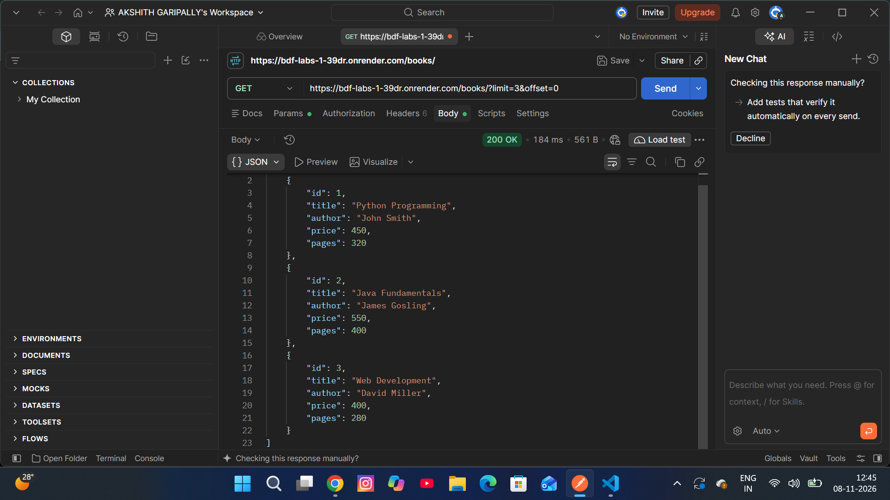
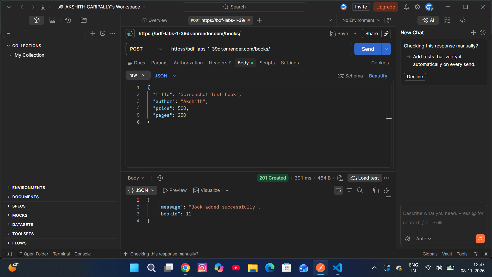
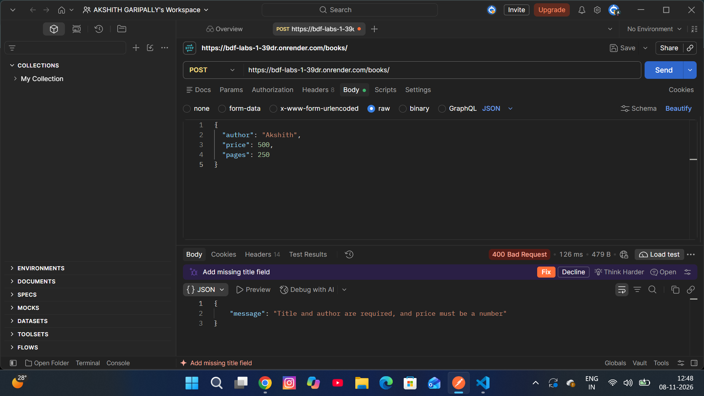
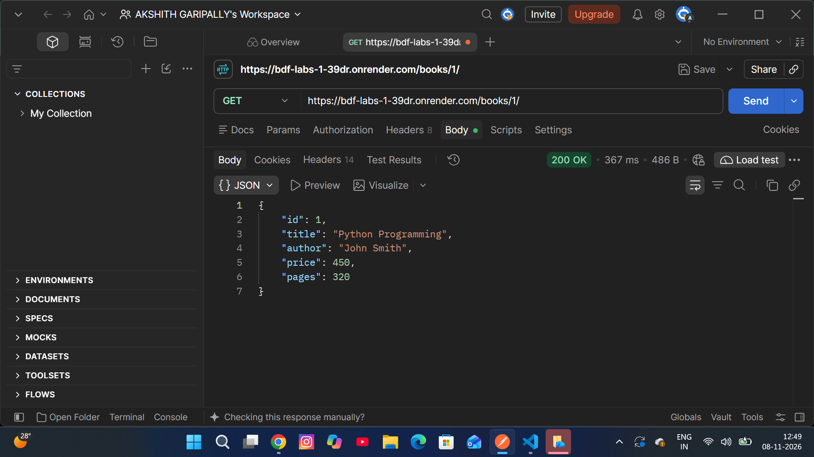
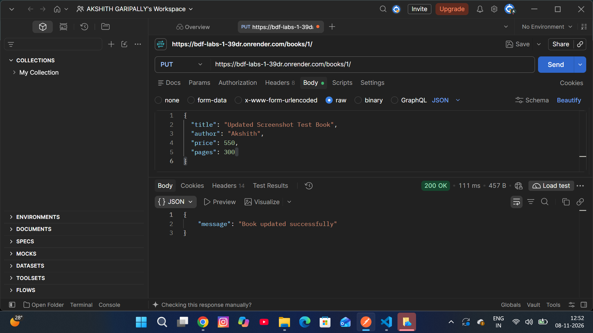
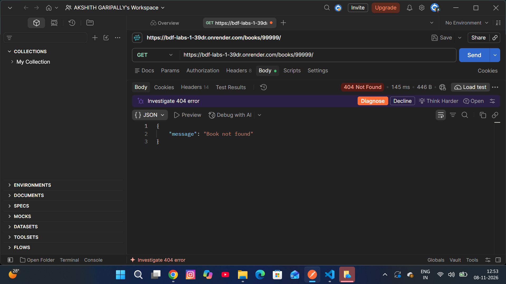
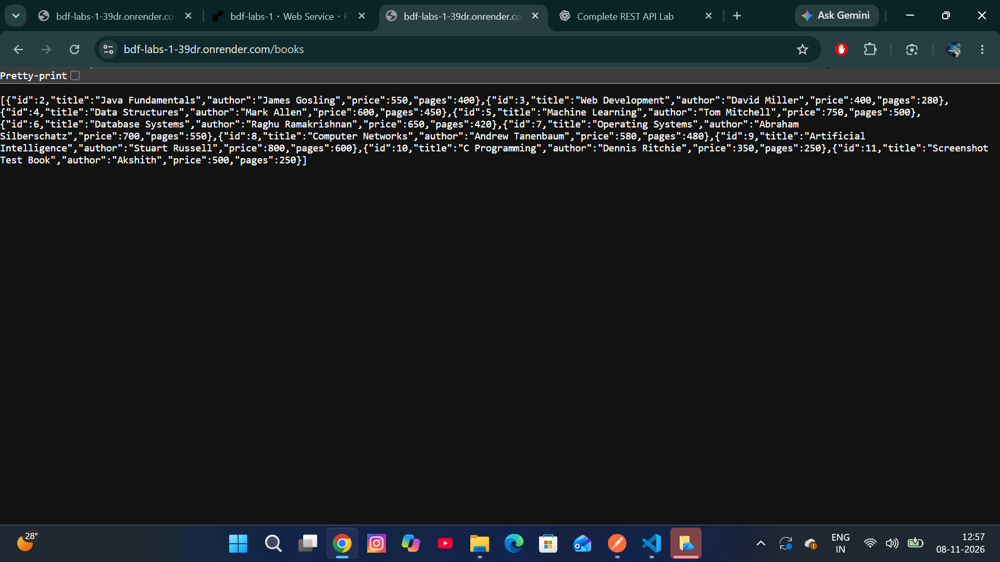

# Lab 3: REST API, Query Parameters, Validation and Debugging

**Student Name:** Akshith Garipally  
**Registration Number:** 252U1R6075
**Section:** S 02 
**Course:** Backend Development Fundamentals  
**University:** Aurora Deemed to be University

## Live Deployment

**Render URL:** https://bdf-labs-1-39dr.onrender.com

**Test API:** https://bdf-labs-1-39dr.onrender.com/books/

The REST API is deployed using Render.

---

## 1. Objective

The objective of this lab is to develop a REST API using Node.js, Express.js and SQLite.

The API supports CRUD operations, searching, sorting, pagination, price filtering, input validation and appropriate HTTP status codes.

## 2. Technologies Used

- Node.js
- Express.js
- SQLite
- sqlite3
- Postman
- Render
- GitHub

## 3. Project Structure

```text
lab-03/
│
├── screenshots/
│   ├── 01-get-all-books.png
│   ├── 02-search-books.png
│   ├── 03-sorting-books.png
│   ├── 04-pagination.png
│   ├── 05-price-filter.png
│   ├── 06-add-book.png
│   ├── 07-validation-error.png
│   ├── 08-get-single-book.png
│   ├── 09-update-book.png
│   ├── 10-delete-book.png
│   ├── 11-book-not-found.png
│   └── 12-deployed-api.png
│
├── .gitignore
├── package.json
├── package-lock.json
├── server.js
└── README.md
```

## 4. Installation and Setup

### Prerequisites

- Node.js installed
- VS Code
- Postman

### Steps to Run the Project

1. Clone the GitHub repository:

```bash
git clone https://github.com/Akshith-45/bdf-labs.git
```

2. Navigate to the Lab 3 directory:

```bash
cd bdf-labs/lab-03
```

3. Install dependencies:

```bash
npm install
```

4. Start the server:

```bash
npm start
```

The server runs on the configured port. The default local port is 3001.

### Environment Variables

| Variable | Description |
|---|---|
| PORT | Port number used by the server |

The application uses the configured SQLite database file.

## 5. API Endpoints

| HTTP Method | Endpoint | Description |
|---|---|---|
| GET | `/books/` | Retrieve all books |
| GET | `/books/:bookId/` | Retrieve a book by ID |
| POST | `/books/` | Add a new book |
| PUT | `/books/:bookId/` | Update an existing book |
| DELETE | `/books/:bookId/` | Delete a book |

## 6. Query Parameters

The GET `/books/` endpoint supports the following query parameters:

| Parameter | Description |
|---|---|
| `search_q` | Search books using a partial title match |
| `order_by` | Select the column used for sorting |
| `order` | Set sorting order to ASC or DESC |
| `limit` | Limit the number of returned records |
| `offset` | Skip a specified number of records |
| `min_price` | Set the minimum book price |
| `max_price` | Set the maximum book price |

### Example Requests

**Search:**
```text
GET /books/?search_q=Python
```

**Sorting:**
```text
GET /books/?order_by=price&order=ASC
```

**Pagination:**
```text
GET /books/?limit=3&offset=0
```

**Price Filtering:**
```text
GET /books/?min_price=400&max_price=700
```

## 7. Validation and HTTP Status Codes

The API uses appropriate HTTP status codes to communicate the result of each request.

| Status Code | Meaning |
|---|---|
| 200 OK | Successful retrieval, update or deletion |
| 201 Created | Book successfully created |
| 400 Bad Request | Invalid or missing input |
| 404 Not Found | Requested book ID does not exist |
| 500 Internal Server Error | Unexpected server error |

POST requests validate required fields such as title, author and numeric price.

## 8. Postman Testing and Screenshots

### 8.1 Get All Books

Retrieves the list of all available books.



### 8.2 Search Books

Searches for books using a partial title match.



### 8.3 Sorting Books

Sorts books by price in ascending order.



### 8.4 Pagination

Retrieves a limited number of books using limit and offset.



### 8.5 Price Filtering

Filters books based on minimum and maximum prices.


### 8.6 Add a Book

Creates a new book using a POST request.



### 8.7 Validation Error

Tests invalid input and verifies the 400 Bad Request response.



### 8.8 Get a Single Book

Retrieves an individual book using its ID.



### 8.9 Update a Book

Updates the details of an existing book using a PUT request.



### 8.10 Delete a Book

Deletes an existing book using a DELETE request.


### 8.11 Book Not Found

Tests a nonexistent book ID and verifies the 404 Not Found response.



### 8.12 Live Deployment

Shows the successfully deployed REST API on Render.



## 9. Problems Faced and Solutions

1. **Port Configuration:** Configured the application to use the port provided by the deployment platform through the PORT environment variable.

2. **SQLite Compatibility:** Encountered a SQLite native module compatibility issue during Render deployment. Changed the sqlite3 dependency to a compatible version and redeployed successfully.

3. **Database Connection:** Verified the SQLite database connection and table initialization before starting the server.

4. **API Testing:** Used Postman to test the API endpoints, query parameters, validation and HTTP responses.

## 10. Conclusion

This lab helped me understand REST API development using Node.js, Express.js and SQLite. I implemented CRUD operations, query parameters, searching, sorting, pagination, price filtering and input validation.

I also learned how to test APIs using Postman, handle errors using appropriate HTTP status codes and deploy a backend application using Render.
