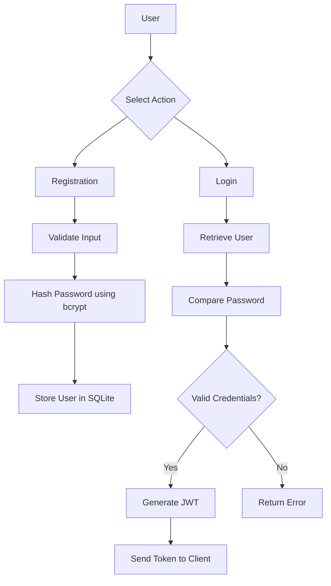

# 🔐 Lab 04 — User Authentication System

\<p align="center">
&#x20; \<strong>Registration • Login • Password Hashing • JWT Authentication\</strong>
\</p>

\<p align="center">


\


\</p>

---

## 📌 Overview

This project implements a user authentication system using **Node.js, Express.js, and SQLite**. It provides APIs for user registration and login, with passwords securely hashed using bcrypt before being stored in the database.

After successful login, the server generates a **JSON Web Token (JWT)** containing the authenticated user's username. The application also handles duplicate registrations, invalid credentials, and missing input fields.

---

## 🎯 Objectives

- Create REST APIs for user registration and login.
- Store user credentials in an SQLite database.
- Hash passwords using bcrypt.
- Prevent duplicate user registrations.
- Validate login credentials.
- Generate JWT tokens after successful authentication.
- Test API functionality using Postman.

---

## 🛠️ Tech Stack

| Technology   | Description                                    |
| ------------ | ---------------------------------------------- |
| Node.js      | JavaScript runtime environment                 |
| Express.js   | Web framework for building APIs                |
| SQLite3      | Lightweight relational database                |
| bcrypt       | Password hashing and verification              |
| jsonwebtoken | JWT creation and signing                       |
| Postman      | API testing                                    |
| Nodemon      | Automatic server restarting during development |

---

## 📂 Project Structure

```text
lab-04/
│
├── server.js
├── package.json
├── package-lock.json
├── userDatabase.db
├── README.md
│
└── screenshots/
    ├── 01-user-registration-success.png
    ├── 02-duplicate-registration-error.png
    ├── 03-login-success.png
    ├── 04-login-invalid-password.png
    ├── 05-login-invalid-username.png
    ├── 06-login-missing-password.png
    ├── 07-register-missing-password.png
    ├── 08-register-missing-username.png
    ├── 09-database-hashed-password.png
    └── 10-jwt-decoded.png
```

---

## ⚙️ Installation & Setup

### 1. Clone the repository

```bash
git clone https://github.com/Akshith-45/bdf-labs.git
```

### 2. Navigate to Lab 4

```bash
cd bdf-labs/lab-04
```

### 3. Install dependencies

```bash
npm install
```

### 4. Start the development server

```bash
npm run dev
```

The server will start at:

```text
http://localhost:3001
```

---

## 🚀 API Endpoints

### 📝 1. User Registration

Registers a new user and stores their hashed password in the database.

**Endpoint**

```http
POST /register/
```

**Request Body**

```json
{
  "username": "student_demo",
  "password": "your_password"
}
```

**Success Response — `201 Created`**

```json
{
  "message": "User created successfully"
}
```

**Duplicate User Response — `400 Bad Request`**

```json
{
  "error_msg": "User already exists"
}
```

**Missing Fields Response — `400 Bad Request`**

```json
{
  "error_msg": "Username and password are required"
}
```

---

### 🔑 2. User Login

Authenticates a registered user and returns a JWT token.

**Endpoint**

```http
POST /login/
```

**Request Body**

```json
{
  "username": "student_demo",
  "password": "your_password"
}
```

**Success Response — `200 OK`**

```json
{
  "jwt_token": "generated_jwt_token"
}
```

**Error Responses**

| Condition               | Response                                               |
| ----------------------- | ------------------------------------------------------ |
| Username does not exist | `400 Bad Request – Invalid user`                       |
| Incorrect password      | `400 Bad Request – Invalid password`                   |
| Missing credentials     | `400 Bad Request – Username and password are required` |

---

## 🔄 Authentication Workflow



---

## 🔒 Security Implementation

### Password Hashing

- Passwords are hashed using `bcrypt`.
- Hashed passwords are stored in SQLite.
- Plain-text passwords are not stored in the database.
- `bcrypt.compare()` is used to verify passwords during login.

### JSON Web Token (JWT)

- Tokens are generated after successful login.
- The username is included in the JWT payload.
- Tokens are signed using the HS256 algorithm.
- The JWT can be decoded to inspect its payload.

---

## 🧪 Test Cases

The application was tested using Postman with valid and invalid inputs.

|  # | Test Scenario                 | Expected Result             | Status |
| -: | ----------------------------- | --------------------------- | :----: |
| 01 | Register a new user           | `201 Created`               |    ✅   |
| 02 | Register duplicate user       | `400 Bad Request`           |    ✅   |
| 03 | Login with valid credentials  | `200 OK` + JWT              |    ✅   |
| 04 | Login with incorrect password | `400 Bad Request`           |    ✅   |
| 05 | Login with unknown username   | `400 Bad Request`           |    ✅   |
| 06 | Login without password        | `400 Bad Request`           |    ✅   |
| 07 | Register without password     | `400 Bad Request`           |    ✅   |
| 08 | Register without username     | `400 Bad Request`           |    ✅   |
| 09 | Verify stored password hash   | Bcrypt hash stored          |    ✅   |
| 10 | Decode JWT token              | Username visible in payload |    ✅   |

---

# 📸 Screenshots & Demonstration

\<details>
\<summary>\<strong>01 — User Registration Success\</strong>\</summary>


\</details>

\<details>
\<summary>\<strong>02 — Duplicate Registration Error\</strong>\</summary>


\</details>

\<details>
\<summary>\<strong>03 — Login Success & JWT Generation\</strong>\</summary>


\</details>

\<details>
\<summary>\<strong>04 — Login with Invalid Password\</strong>\</summary>


\</details>

\<details>
\<summary>\<strong>05 — Login with Unknown Username\</strong>\</summary>


\</details>

\<details>
\<summary>\<strong>06 — Login with Missing Password\</strong>\</summary>


\</details>

\<details> \<summary>\<strong>07 — Registration with Missing Password\</strong>\</summary>


\</details>

\<details> \<summary>\<strong>08 — Registration with Missing Username\</strong>\</summary>


\</details>

\<details> \<summary>\<strong>09 — Password Hash Stored in SQLite\</strong>\</summary>


\</details>

\<details>
\<summary>\<strong>10 — Decoded JWT Payload\</strong>\</summary>


\</details>

---

## 📚 Concepts Learned

- REST API development using Express.js
- HTTP POST requests and JSON handling
- SQLite database integration
- Password hashing with bcrypt
- Password verification
- JWT generation and decoding
- Authentication flow
- HTTP status codes
- API testing using Postman
- Automatic server restarting with Nodemon

---

## ✅ Result

A functional authentication system was successfully developed using Node.js and Express.js.

The application supports user registration and login, stores hashed passwords in SQLite, validates credentials, handles invalid requests, and generates JWT tokens after successful authentication.

---

\<p align="center">
&#x20; \<strong>Backend Development Fundamentals · Lab 04\</strong>
\</p>
